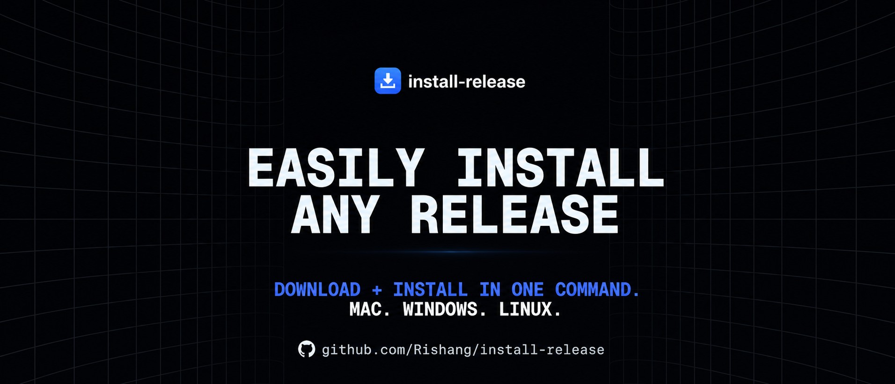
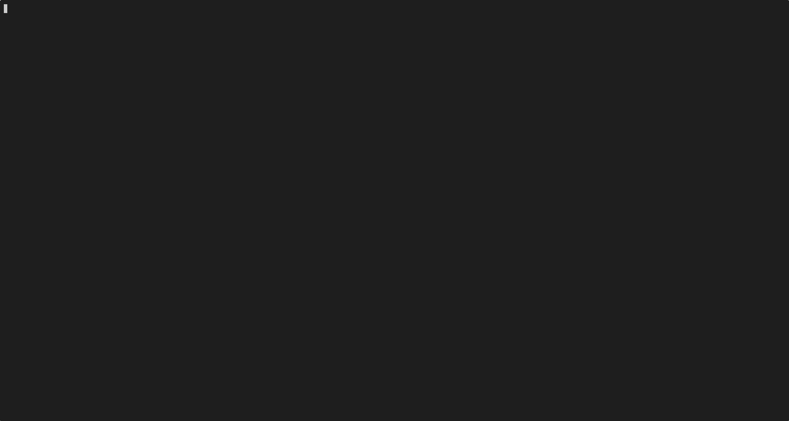

<p align="center">
  
</p>
<p align="center">
  <em>CLI to install any CLI</em>
  <br><br>
  <a href="https://bun.sh/">
    
  </a>
  <a href="https://www.npmjs.com/package/hacker-install">
    
  </a>
  <a href="./LICENSE">
    
  </a>
</p>

<br>

**Hacker Install** gives you the `hi` command to install and keep single-binary CLI tools updated on Linux, macOS, and WSL. It works with GitHub, GitLab, and Forgejo-powered Codeberg releases, and supports mise/aqua registry entries and Docker images.

This is the TypeScript/Bun implementation and the only maintained version of Hacker Install. It replaces the original Python CLI (archived as [`hacker-install-python`](https://github.com/lamnguyenx/hacker-install-python)) and owns all config/state under `~/.config/hacker/hacker-install/` and `~/.local/state/hacker/hacker-install/`.

<a href="#getting-started"></a>

> INFO: It is mainly for installing tools that are not directly available from package managers like `apt`, `yum`, `pacman`, or `brew`.

<p align="center">
  
</p>

## Highlights

- **GitHub, GitLab, Codeberg/Forgejo releases** — give `hi` a repository URL and it finds the right asset for your OS and architecture.
- **Self-hosted GitLab and Forgejo** — `gitlab@host/owner/repo` and `forgejo@host/owner/repo`.
- **Package mode** — install `.deb`, `.rpm`, or AppImage assets with `--pkg`.
- **mise/aqua registry** — `mise@terraform`, including HTTP-download tools.
- **Docker images** — wrap any image as a local CLI with `docker@image`.
- **Interactive asset selection** — pick a specific release asset when automatic selection is not enough.
- **State sync** — export/import your installed-tool list with `hi pull`.
- **Readable output** — width-aware, colour-coded lists that stay intact in narrow terminals and when piped.
- **No libmagic dependency** — archive and executable detection is built in.

## Table of Contents

- [Getting started](#getting-started)
  - [Install a standalone binary](#option-1-standalone-binary-recommended)
  - [Install with Bun/npm](#option-2-bun-or-npm)
  - [Build from source](#option-3-build-from-source)
- [Quick start](#quick-start)
- [Commands](#commands)
- [Install from GitHub, GitLab, and Codeberg](#install-from-github-gitlab-and-codeberg)
  - [Self-hosted GitLab and Forgejo](#self-hosted-gitlab-and-forgejo)
  - [Install as a system package](#install-as-a-system-package-debrpmappimage)
- [Install via mise/aqua](#install-via-miseaqua)
- [Install a Docker image as a CLI](#install-a-docker-image-as-a-cli)
- [Choose a specific release asset](#choose-a-specific-release-asset)
- [Manage installed tools](#manage-installed-tools)
  - [List](#list-installed-tools)
  - [Info](#show-info-about-an-installed-tool)
  - [Remove](#remove-an-installed-tool)
  - [Upgrade](#update-installed-tools)
  - [Hold](#hold-updates)
- [Sync state with `hi pull`](#sync-state-with-hi-pull)
- [Configuration](#configuration)
  - [Install path](#install-path)
  - [Bundle path](#bundle-path)
  - [Pre-releases](#pre-releases)
  - [Provider tokens](#provider-tokens)
- [Config and state format](#config-and-state-format)
- [Upgrading from the Python version](#upgrading-from-the-python-version)
- [Requirements](#requirements)
- [Development](#development)
- [Versioning and releases](#versioning-and-releases)
- [Docs](#docs)
- [Release assets](#release-assets)
- [License](#license)

## Getting started

### Option 1: Standalone binary (recommended)

Download the latest binary for your platform from [GitHub Releases](https://github.com/lamnguyenx/hacker-install/releases). No Bun installation is required.

#### Linux x86_64 (glibc)

```bash
mkdir -p ~/bin
curl -Lo ~/bin/hi https://github.com/lamnguyenx/hacker-install/releases/latest/download/hacker-install-linux-x86_64
chmod +x ~/bin/hi
```

#### Linux aarch64 (glibc)

```bash
curl -Lo ~/bin/hi https://github.com/lamnguyenx/hacker-install/releases/latest/download/hacker-install-linux-aarch64
chmod +x ~/bin/hi
```

#### Alpine/musl

Use `hacker-install-linux-x86_64-musl` or `hacker-install-linux-aarch64-musl`. The musl build needs the C++ runtime:

```bash
apk add libstdc++
```

#### macOS

```bash
# Apple Silicon
curl -Lo ~/bin/hi https://github.com/lamnguyenx/hacker-install/releases/latest/download/hacker-install-darwin-arm64

# Intel
curl -Lo ~/bin/hi https://github.com/lamnguyenx/hacker-install/releases/latest/download/hacker-install-darwin-x86_64

chmod +x ~/bin/hi
```

Then register the binary under the name `hi` so `hi me --upgrade` updates the same file:

```bash
~/bin/hi get https://github.com/lamnguyenx/hacker-install -n hi
```

Add `~/bin` to your `PATH`:

```bash
# Bash
echo 'export PATH="$HOME/bin:$PATH"' >> ~/.bashrc

# Zsh
echo 'export PATH="$HOME/bin:$PATH"' >> ~/.zshrc

# Fish
echo 'set -gx PATH $HOME/bin $PATH' >> ~/.config/fish/config.fish
```

### Option 2: Bun or npm

The npm package is a Bun-target bundle, so Bun 1.4+ must be installed.

```bash
# With Bun (recommended)
bun add -g hacker-install

# Or with npm; the `hi` launcher runs through Bun
npm install -g hacker-install
```

The package installs a single command: `hi`.

> Installing from a local clone? Use `bun link` (after `bun run build:npm`) so the command tracks your checkout, or `bun add -g "$PWD"` / `npm i -g .` for a copy. `bun add -g .` is broken in Bun 1.4.3 — it resolves the relative spec to an empty package name.

> If you installed globally with Bun/npm, update with `bun update -g hacker-install` or `npm update -g hacker-install`. `hi me --upgrade` detects a global package install and prints this reminder instead of overwriting `~/bin/hi`.

### Option 3: Build from source

```bash
git clone https://github.com/lamnguyenx/hacker-install
cd hacker-install
bun install
bun run dev -- --help

# Compile a native binary for the current platform
bun run build
./dist/hacker-install-<platform> --help

# Build the npm bundle and link the CLI locally
bun run build:npm
bun link
```

## Quick start

```bash
# Install Deno from GitHub releases
hi get https://github.com/denoland/deno

# Install the GitLab CLI with a custom command name
hi get https://gitlab.com/gitlab-org/cli -n glab

# Install from Codeberg/Forgejo
hi get https://codeberg.org/forgejo/forgejo

# Install from the mise/aqua registry
hi get mise@terraform

# Wrap a Docker image as a local CLI
hi get docker@hashicorp/terraform

# See what is installed
hi ls

# Upgrade everything
hi upgrade
```

## Commands

```text
hi get <url> [options]        Install a CLI tool
hi upgrade [name] [options]   Upgrade installed tools
hi ls [options]               List installed tools
hi info <name>                Show info about an installed tool
hi rm [name]                  Remove an installed tool
hi config [options]           Update configuration
hi state                      Print the raw state file
hi pull --url <url>           Install tools from a remote state URL
hi hold [name] [--unset]      Hold/unhold updates for a tool
hi me [options]               Show version or self-upgrade
```

Run `hi <command> --help` for command-specific options.

### Shell completion

```bash
# Show completion script
hi --show-completion zsh

# Install completion for the current or specified shell
hi --install-completion zsh
hi --install-completion bash
hi --install-completion fish
```

## Install from GitHub, GitLab, and Codeberg

Supported URL forms:

```text
https://github.com/<owner>/<repo>
https://gitlab.com/<group>/<repo>
https://codeberg.org/<owner>/<repo>
```

```bash
hi get https://github.com/denoland/deno
hi get https://gitlab.com/gitlab-org/cli -n glab
hi get https://codeberg.org/forgejo/forgejo
```

`hi` reads the latest stable release, scores every asset for your OS, architecture, libc, and package family, and installs the best match. If a directory-wrapped release contains `bin/<tool>`, the whole tree is kept and `bin/<tool>` is symlinked into your install path.

Useful options:

```text
-t, --tag <tag>       Select a specific release version
-f, --file <file>     Select a specific release asset filename
-n, --name <name>     Install under a custom command name
-y, --yes             Skip the confirmation prompt
--pkg                 Install a deb/rpm/AppImage package
--docker-opts <opts>  Extra docker run options (docker@ only)
```

### Self-hosted GitLab and Forgejo

Self-hosted instances use a provider prefix. HTTPS is assumed:

```text
gitlab@<host>/<group>/<repo>
forgejo@<host>/<owner>/<repo>
```

```bash
# GitLab subgroups are supported
hi get gitlab@gitlab.example.com/group/subgroup/mytool

# Self-hosted Forgejo/Gitea
hi get forgejo@git.example.com/owner/mytool
```

Tokens are stored per host. See [Provider tokens](#provider-tokens).

### Install as a system package (deb/rpm/AppImage)

Use `--pkg` when a project ships a package that integrates with your OS:

```bash
hi get https://github.com/redis/RedisInsight --pkg
```

`hi` detects your package family from `/etc/os-release`, falling back to available package managers. On Linux it can install:

- `.deb` via `dpkg`/`apt`
- `.rpm` via `dnf`/`yum`/`rpm`
- AppImage into `~/.local/share/appimages` with a desktop entry and icon

Package installation is Linux-only. `hi upgrade` reports pending package upgrades but does not install them unless you run `hi upgrade --pkg`.

## Install via mise/aqua

Some tools do not publish platform assets on their GitHub releases. For those, use the mise registry with the `mise@` prefix:

```bash
hi get mise@terraform

# Pin a version inline or with --tag
hi get mise@terraform:v1.12.0
hi get mise@terraform -t v1.12.0
```

`hi` resolves the mise registry entry, expands the aqua asset URL template for your OS/architecture, downloads it, and installs the binary. Tools installed this way are tracked and upgraded like Git tools.

> The mise provider currently supports `github_release` and `http` aqua package types.

## Install a Docker image as a CLI

Wrap any Docker image as a local command:

```bash
hi get docker@hashicorp/terraform
hi get docker@hashicorp/terraform:1.7.0
hi get docker@hashicorp/terraform -t 1.7.0

# Custom command name
hi get docker@mcr.microsoft.com/azure-cli -n az

# Extra docker run options (raw shell; quote spaces)
hi get docker@alpine:latest -n alpine --docker-opts "-v $HOME/data:/data"
```

`hi` pulls the image, detects its entrypoint, and writes an executable wrapper to your install path. The wrapper mounts the current directory at `/tmp/cmd` and runs:

```sh
docker run --rm -i $termflag -v "$PWD:/tmp/cmd" -w /tmp/cmd <opts> <image> <args>
```

Behavior:

- `latest` tags are checked by digest during `hi upgrade` and re-pulled only when the registry digest changes.
- Pinned tags are held from automatic upgrades; `hi upgrade --force` re-pulls them.
- `--docker-opts` is persisted in state and reused on upgrade.
- Re-running `hi get` without `--docker-opts` preserves saved options; pass `--docker-opts ""` to clear them.

## Choose a specific release asset

If automatic selection picks the wrong asset, use interactive selection or `--file`.

### Interactive selection

```bash
hi get https://github.com/ekzhang/bore
```

At the prompt, enter an asset ID instead of `y`:

```text
Install selected tool? [Y/n/ Asset ID]: 3
```

`hi` stores the selected filename's keywords so future upgrades keep the same variant.

### `--file`

```bash
hi get https://github.com/ekzhang/bore -f bore-v0.4.0-arm-unknown-linux-musleabi.tar.gz
```

The filename is parsed into keywords (`bore`, `arm`, `linux`, `musleabi`, ...) and stored for upgrades.

## Manage installed tools

### List installed tools

```bash
hi ls
hi ls --json
hi ls --hold
```

Output adapts to the terminal width — no borders, no wrapping:

```text
Installed tools (2)

  code-server · v4.143.1 · binary · github
  github.com/coder/code-server · VS Code in the browser

  lazygit · v0.54.1 · binary · github · held
  github.com/jesseduffield/lazygit · Simple terminal UI for git commands
```

Held tools carry a bold yellow `held` tag. Low-priority columns are dropped before anything is cut mid-word, and piped output is never truncated. `hi ls --json` prints an array with `name`, `version`, `type`, `hold`, `source`, and `description` fields for scripts.

### Show info about an installed tool

```bash
hi info kubectx
```

### Remove an installed tool

```bash
hi rm gron
```

For packages, `hi rm` uses the actual package-manager name recorded at install time. For directory-wrapped releases, it removes both the symlink and the bundle tree.

### Update installed tools

```bash
# Upgrade all tools
hi upgrade

# Upgrade one tool
hi upgrade zen

# Upgrade only packages
hi upgrade --pkg

# Force reinstall even when the published date is unchanged
hi upgrade --force
```

`hi upgrade` checks tools concurrently, prints the pending upgrades, and asks for confirmation. Use `-y` to skip the prompt.

### Hold updates

```bash
hi hold k9s
hi ls --hold
hi hold k9s --unset
```

## Sync state with `hi pull`

Export your TS state file somewhere accessible and install the same tools on another machine:

```bash
hi pull --url https://raw.githubusercontent.com/you/dotfiles/main/hacker-install/state.json

# Also reinstall tools whose local version differs
hi pull --url https://example.com/state.json --override
```

The remote file must use the TypeScript state format documented below.

## Configuration

Config lives at:

```text
${XDG_CONFIG_HOME:-~/.config}/hacker/hacker-install/config.jsonc
```

State lives at:

```text
${XDG_STATE_HOME:-~/.local/state}/hacker/hacker-install/state.json
```

For tests or portable setups, `HI_CONFIG_DIR` and `HI_STATE_DIR` override the directories.

### Install path

```bash
hi config --path ~/.local/bin
```

Default: `~/bin`.

### Bundle path

Directory-wrapped releases (for example `bin/code-server` plus a `lib/` runtime) are extracted here. Default: `~/Downloads2`.

Single-file binaries are copied into the install path instead, and downloaded archives are removed after extraction — `bundlePath` is not a download history.

```bash
hi config --bundle-path ~/.local/share/hacker-install
```

### Pre-releases

```bash
# Include pre-releases when checking for updates
hi config --pre-release

# Exclude them again
hi config --no-pre-release
```

Omitting both flags leaves the current setting unchanged.

### Provider tokens

Tokens raise API rate limits and allow authenticated access to private/self-hosted instances.

```bash
# GitHub
hi config --github-token <token>

# GitLab.com
hi config --gitlab-token <token>

# Codeberg/Forgejo
hi config --codeberg-token <token>
```

Hosts are stored per instance:

```bash
hi config --gitlab-token <token> --host gitlab.example.com
hi config --codeberg-token <token> --host git.example.com
```

Self-hosted hosts are registered automatically the first time you install from them, so a token is only needed when the instance requires authentication.

## Config and state format

The config file is JSONC — comments and trailing commas are accepted:

```jsonc
{
  "version": 1,
  "installPath": "~/bin",
  "bundlePath": "~/Downloads2",
  "preRelease": false,
  "tokens": {
    "github": "",
    "gitlab": { "gitlab.com": "" },
    "forgejo": { "codeberg.org": "" }
  }
}
```

State is a JSON object keyed by installed command name:

```json
{
  "version": 1,
  "tools": {
    "deno": {
      "name": "deno",
      "provider": "github",
      "source": "https://github.com/denoland/deno",
      "tagName": "v2.0.0",
      "publishedAt": "2026-01-01T00:00:00Z",
      "prerelease": false,
      "description": "A modern runtime for JavaScript and TypeScript",
      "assets": [],
      "holdUpdate": false,
      "packageType": "binary",
      "installMethod": "binary"
    }
  }
}
```

Provider-specific fields:

- `packageType`: `deb`, `rpm`, `AppImage`, or `binary`
- `installMethod`: `binary` or `package`
- `packageName`: actual package-manager name, when different from the command name
- `dockerOpts`: persisted Docker wrapper options
- `customReleaseWords`: asset keywords chosen with `--file` or interactive selection

Config and state files are written atomically with mode `0600`.

## Upgrading from the Python version

The Python CLI is sunset. Its repository is archived as
[`hacker-install-python`](https://github.com/lamnguyenx/hacker-install-python). This version
owns the same paths, so uninstall the Python entry point first — two `hi` binaries writing the
same files would clobber each other:

```text
~/.config/hacker/hacker-install/config.jsonc
~/.local/state/hacker/hacker-install/state.json
```

The file format changed with the rewrite:

- Config is flat camelCase (`installPath`, `bundlePath`, `preRelease`, `tokens`) instead of the nested `config` object with snake_case keys.
- State is `{ "version": 1, "tools": { "<name>": { ... } } }`, keyed by tool name with camelCase release fields instead of `<source>#<name>` keys with snake_case fields.

The state file only records installed tools — the binaries already live in your install path — so the simplest migration is to reinstall what you use:

```bash
hi config --path ~/.local/bin
hi get https://github.com/coder/code-server
```

Leftover Python-format files are rejected with an error instead of being silently ignored, so `hi` never overwrites them by accident.

## Requirements

- **Standalone binary:** Linux, macOS, or WSL. No runtime dependency. Alpine/musl builds additionally need `libstdc++` (`apk add libstdc++`).
- **npm/Bun install:** Bun 1.4.3 or newer.
- **Extraction:** tar, tar.gz, tar.zst, zip, and raw binaries are handled natively. `.xz`, `.bz2`, and `.7z` archives use the system `xz`, `bzip2`, and `7z` tools when present.
- **Package mode:** Linux and the relevant package manager (`dpkg`/`apt`, `dnf`/`yum`/`rpm`) or AppImage support.
- **Docker mode:** the `docker` CLI.

## Development

```bash
bun install

# Run from source
bun run dev -- --help

# Tests (no network, Docker, or sudo required)
bun test

# Type checking and formatting/linting
bun run typecheck
bun run lint
bun run format
bun run check

# Native standalone binary
bun run build

# All release targets (linux/darwin, x64/arm64, glibc/musl)
bun run build:all

# npm bundle at dist/npm/index.js
bun run build:npm

# Link this checkout as the global `hi` (tracks dist/npm/index.js)
bun link
```

The default test suite is fully mocked: it does not need network access, Docker, sudo, or a real package manager. Real installs can be exercised manually with `bun run dev -- get <url>`.

After changing source, rebuild before checking the linked command: `bun run build:npm`, then run `hi ...`.

## Versioning and releases

Versions use calendar versioning: `YYYY.MM.DD`, for example `2026.10.29`. `package.json` is the single source of truth; `src/version.ts` reads it at build time, so rebuild after a bump before checking `hi --version`.

The npm package `hacker-install` installs only the `hi` command. `npm publish --access public` runs the full gate (`bun run check`, `bun test`, `bun run build:npm`) through `prepublishOnly` and requires 2FA on the npm account.

A brand-new package name is briefly listed as the `0.0.0-stage` placeholder while npm processes it; the real version appears within about a minute. GitHub release tags mirror the version with a `v` prefix (`v2026.10.29`). A published release triggers both the binary build and the npm publish workflows; the npm workflow only publishes when the `NPM_TOKEN` repository secret is set.

See [`docs/important/releasing.md`](docs/important/releasing.md) for the full checklist, auth fallbacks, and verification steps.

## Docs

- [`docs/important/`](docs/important/) — durable notes: config/state contract, install flow, CLI output style, versioning and releases.
- [`docs/plans/`](docs/plans/) — dated implementation write-ups, including trials, errors, and lessons learnt.

## Release assets

| Asset                               | Platform            | Libc  |
| ----------------------------------- | ------------------- | ----- |
| `hacker-install-linux-x86_64`       | Linux x86_64        | glibc |
| `hacker-install-linux-aarch64`      | Linux ARM64         | glibc |
| `hacker-install-linux-x86_64-musl`  | Linux x86_64        | musl  |
| `hacker-install-linux-aarch64-musl` | Linux ARM64         | musl  |
| `hacker-install-darwin-x86_64`      | macOS Intel         | —     |
| `hacker-install-darwin-arm64`       | macOS Apple Silicon | —     |

`dist/checksums.txt` contains SHA-256 checksums when building with `--all`.

Release tags use the same calendar version with a `v` prefix (`v2026.10.29`); the npm package uses the version without the prefix.

## License

GPL-3.0. See [LICENSE](./LICENSE).
