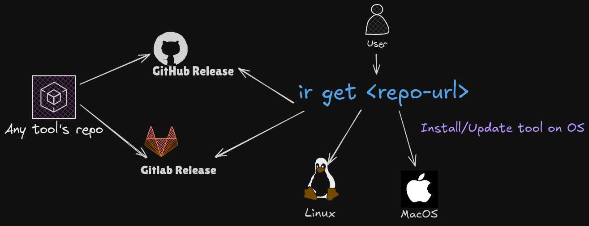

# Install flow and on-disk layout

<p align="center">
  
</p>

Two settings define where things end up:

| Setting       | Default        | Holds                                                               |
| ------------- | -------------- | ------------------------------------------------------------------- |
| `installPath` | `~/bin`        | the command you run: single binaries, wrapper scripts, and symlinks |
| `bundlePath`  | `~/Downloads2` | directory-wrapped releases, plus per-install temp dirs              |

`hi get` always runs with `local = true`, so it never calls `sudo`. Writes go to user-owned
paths; the `sudo` branches in `src/helper/install.ts` are for the non-local mode.

## What happens during `hi get`

```text
bundlePath/dn_<repo>_<random>/     <- temp dir, created per install
        │  download + extract
        ├── single binary  ──copy──▶  installPath/<name>
        │                              (temp dir deleted)
        └── directory bundle (has bin/<name>)
                │  move whole package dir
                ▼
            bundlePath/<name>/      <- kept
                └── bin/<name>
                        ▲
        installPath/<name> ──symlink──┘
```

Key points (source: `src/providers/git/main.ts` `get()`, `src/helper/install.ts`):

- The download directory is a **temp dir under `bundlePath`**, named `dn_<repo>_<hex>`.
  It is removed in a `finally` block, **including the archive**. Archives are not kept.
- A _bundle_ is detected by a launcher at `<pkg>/bin/<name>` or `<pkg>/<sub>/bin/<name>`.
  Exactly one match is required. The package dir is moved, not copied, to
  `bundlePath/<name>`; `installPath/<name>` is a symlink to `bundlePath/<name>/bin/<name>`.
- A _single binary_ is installed with `install <src> <installPath>/<name>` (a copy).
  There is no symlink and no retained archive.
- If several executables are found where one was expected, the install fails rather than
  guessing.
- `--name` (and the tool name derived from the repo) decides the destination filename.
- mise installs use the same helper (`src/providers/mise/main.ts`), so bundles behave the same.
- OS packages (`--pkg`: deb/rpm/AppImage) bypass this flow entirely; they are installed by the
  system package manager and only recorded in state.
- Docker installs write a wrapper script to `installPath/<name>`; the image is not stored.

## Downloads

`hi` prefers `aria2c` when it is installed: `--continue=true` (resume), `--split=8` and
`--max-connection-per-server=8` by default. aria2c runs quietly and the CLI draws its own
single-line progress bar from the growing file size. When aria2c is missing, fails, or stops
short, the built-in downloader resumes the same partial file with an HTTP `Range` request.
Archives still live only in the per-install temp dir and are deleted after extraction.

## Removal (`hi rm`)

`src/app/manage.ts` removes:

1. `installPath/<name>` (the binary, wrapper, or symlink).
2. `bundlePath/<name>` **only when** the install path entry was a symlink pointing inside that
   bundle. A real file is never followed into the bundle directory.

Package installs are removed through the package manager instead.

## Implications

- `bundlePath` is not a download history. If you want to keep tarballs, that needs a new
  option (see the follow-up in the
  [2026-10-26 plan](../../plans/2026/10/26/2026-10-26-global-install-config-sunset-and-list-ux.md)).
- Moving `bundlePath` breaks existing bundle symlinks in `installPath`. Re-run the installs,
  or fix the links.
- `installPath` must be on `PATH`; `bundlePath` must not be.
- The global `hi` itself is separate from this flow. `bun link` points `~/.bun/bin/hi` at
  `dist/npm/index.js` in the checkout, so it runs the last build; for an editable install that
  runs `src/index.ts` directly, see [Local development](../development/local-setup.md). End
  users normally install `hacker-install` from npm or download a standalone binary;
  `hi me --upgrade` updates the standalone binary, not an npm install.
